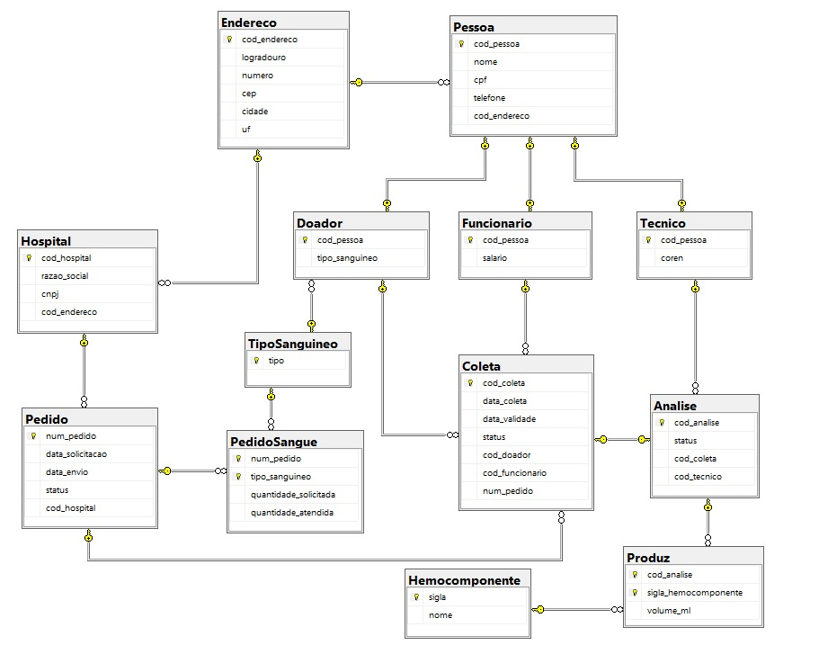
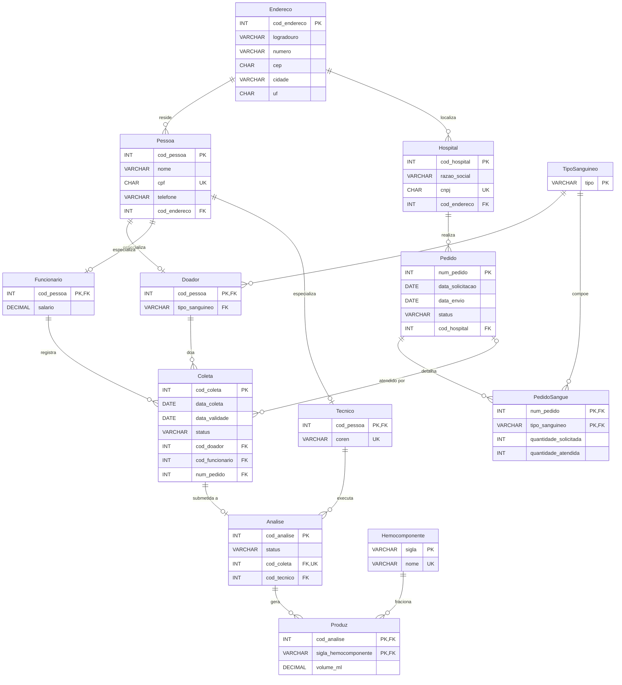

# DER do Banco de Dados — Hemocentro (Java Puro + SQL Server)

Documentação do Modelo Entidade-Relacionamento (DER) correspondente à implementação em **Java 21 puro** (`src/`) e ao script DDL em **SQL Server** (`hemocentro.sql`).

---

## 1. Diagrama Entidade-Relacionamento (DER)

---

## 2. Dicionário de Tabelas e Mapeamento Java (`src/`)

### 2.1 Tabelas de Apoio

| Tabela | Colunas e Tipos (SQL Server) | Restrições | Classe / Enum em `src/` |
| :--- | :--- | :--- | :--- |
| `Endereco` | `cod_endereco INT IDENTITY(1,1)`, `logradouro VARCHAR(150)`, `numero VARCHAR(10)`, `cep CHAR(8)`, `cidade VARCHAR(100)`, `uf CHAR(2)` | PK `cod_endereco`; todos `NOT NULL` | `Endereco.java` |
| `TipoSanguineo` | `tipo VARCHAR(15)` | PK `tipo`; valores iniciais: `A+`, `A-`, `B+`, `B-`, `AB+`, `AB-`, `O+`, `O-`, `Não informado` | `TipoSanguineo.java` |
| `Hemocomponente` | `sigla VARCHAR(5)`, `nome VARCHAR(50)` | PK `sigla`; `nome` `NOT NULL UNIQUE`; valores iniciais: `CH`, `CP`, `CRIO`, `PFC` | `Hemocomponente.java` |

### 2.2 Pessoas e Especializações (Herança em `src/`)

| Tabela | Colunas e Tipos (SQL Server) | Restrições e Relacionamentos | Classe em `src/` |
| :--- | :--- | :--- | :--- |
| `Pessoa` | `cod_pessoa INT IDENTITY(1,1)`, `nome VARCHAR(100)`, `cpf CHAR(11)`, `telefone VARCHAR(11)`, `cod_endereco INT` | PK `cod_pessoa`; `cpf` `UNIQUE`; FK `cod_endereco -> Endereco(cod_endereco)` | `Pessoa.java` |
| `Doador` | `cod_pessoa INT`, `tipo_sanguineo VARCHAR(15)` | PK/FK `cod_pessoa -> Pessoa(cod_pessoa) ON DELETE CASCADE`; FK `tipo_sanguineo -> TipoSanguineo(tipo)` | `Doador.java` (`extends Pessoa`) |
| `Funcionario` | `cod_pessoa INT`, `salario DECIMAL(10,2)` | PK/FK `cod_pessoa -> Pessoa(cod_pessoa) ON DELETE CASCADE` | `Funcionario.java` (`extends Pessoa`) |
| `Tecnico` | `cod_pessoa INT`, `coren VARCHAR(20)` | PK/FK `cod_pessoa -> Pessoa(cod_pessoa) ON DELETE CASCADE`; `coren` `UNIQUE` | `Tecnico.java` (`extends Pessoa`) |

### 2.3 Hospitais e Pedidos

| Tabela | Colunas e Tipos (SQL Server) | Restrições e Relacionamentos | Classe / Enum em `src/` |
| :--- | :--- | :--- | :--- |
| `Hospital` | `cod_hospital INT IDENTITY(1,1)`, `razao_social VARCHAR(150)`, `cnpj CHAR(14)`, `cod_endereco INT` | PK `cod_hospital`; `cnpj` `UNIQUE`; FK `cod_endereco -> Endereco(cod_endereco)` | `Hospital.java` |
| `Pedido` | `num_pedido INT IDENTITY(1,1)`, `data_solicitacao DATE`, `data_envio DATE NULL`, `status VARCHAR(30)`, `cod_hospital INT` | PK `num_pedido`; `status` DEFAULT `'PENDENTE'` (`CHECK` IN `'PENDENTE'`, `'EM_ATENDIMENTO'`, `'ATENDIDO'`, `'CANCELADO'`); FK `cod_hospital -> Hospital(cod_hospital)` | `Pedido.java` + `StatusPedido.java` |
| `PedidoSangue` | `num_pedido INT`, `tipo_sanguineo VARCHAR(15)`, `quantidade_solicitada INT`, `quantidade_atendida INT` | PK composta (`num_pedido`, `tipo_sanguineo`); FK `num_pedido -> Pedido(num_pedido) ON DELETE CASCADE`; FK `tipo_sanguineo -> TipoSanguineo(tipo)`; `quantidade_solicitada > 0`; `quantidade_atendida >= 0` (DEFAULT `0`); `CHECK (quantidade_atendida <= quantidade_solicitada)` | `PedidoSangue.java` |

### 2.4 Coletas, Análises e Produção de Hemocomponentes

| Tabela | Colunas e Tipos (SQL Server) | Restrições e Relacionamentos | Classe / Enum em `src/` |
| :--- | :--- | :--- | :--- |
| `Coleta` | `cod_coleta INT IDENTITY(1,1)`, `data_coleta DATE`, `data_validade DATE`, `status VARCHAR(10)`, `cod_doador INT`, `cod_funcionario INT`, `num_pedido INT NULL` | PK `cod_coleta`; `status` DEFAULT `'DISPONIVEL'` (`CHECK` IN `'DISPONIVEL'`, `'DESCARTADA'`, `'ENVIADA'`); FKs para `Doador`, `Funcionario` e `Pedido` (`NULL` até a baixa) | `Coleta.java` + `StatusColeta.java` |
| `Analise` | `cod_analise INT IDENTITY(1,1)`, `status VARCHAR(30)`, `cod_coleta INT`, `cod_tecnico INT` | PK `cod_analise`; `status` DEFAULT `'EM_ANALISE'` (`CHECK` IN `'EM_ANALISE'`, `'APROVADA'`, `'REPROVADA'`); FK `cod_coleta -> Coleta(cod_coleta)` com `UNIQUE` (1:1); FK `cod_tecnico -> Tecnico(cod_pessoa)` | `Analise.java` + `StatusAnalise.java` |
| `Produz` | `cod_analise INT`, `sigla_hemocomponente VARCHAR(5)`, `volume_ml DECIMAL(6,2)` | PK composta (`cod_analise`, `sigla_hemocomponente`); FKs para `Analise` e `Hemocomponente`; `CHECK (volume_ml > 0)` | `Producao.java` |

---

## 3. Detalhamento dos Relacionamentos e Regras do Schema

| Bloco | Tabela | Chaves e Restrições Principais | Cardinalidade / Regra de Negócio |
| :--- | :--- | :--- | :--- |
| **Apoio** | `Endereco` | PK `cod_endereco` | Compartilhada por `Pessoa` (1:N) e `Hospital` (1:N). |
| **Apoio** | `TipoSanguineo` | PK `tipo` | Pré-populada com `A+`, `A-`, `B+`, `B-`, `AB+`, `AB-`, `O+`, `O-` e `Não informado`. |
| **Apoio** | `Hemocomponente` | PK `sigla`, UNIQUE `nome` | Pré-populada com `CH`, `CP`, `CRIO` e `PFC`. |
| **Pessoas** | `Pessoa` | PK `cod_pessoa`, UNIQUE `cpf`, FK `cod_endereco` | Entidade-pai de `Doador`, `Funcionario` e `Tecnico`. |
| **Pessoas** | `Doador` | PK/FK `cod_pessoa` (`ON DELETE CASCADE`), FK `tipo_sanguineo` | Especialização 1:0..1 de `Pessoa`. |
| **Pessoas** | `Funcionario` | PK/FK `cod_pessoa` (`ON DELETE CASCADE`), `salario` (`DECIMAL(10,2)`) | Especialização 1:0..1 de `Pessoa`. |
| **Pessoas** | `Tecnico` | PK/FK `cod_pessoa` (`ON DELETE CASCADE`), UNIQUE `coren` | Especialização 1:0..1 diretamente de `Pessoa` (herança em `Tecnico.java`). |
| **Hospitais** | `Hospital` | PK `cod_hospital`, UNIQUE `cnpj`, FK `cod_endereco` | Realiza 0..N `Pedido`. |
| **Hospitais** | `Pedido` | PK `num_pedido`, FK `cod_hospital`, `data_envio` NULL | `status`: `'PENDENTE'`, `'EM_ATENDIMENTO'`, `'ATENDIDO'` ou `'CANCELADO'`. |
| **Hospitais** | `PedidoSangue` | PK composta (`num_pedido`, `tipo_sanguineo`), `ON DELETE CASCADE` | Tabela associativa N:N; `quantidade_solicitada > 0` e `quantidade_atendida >= 0`. |
| **Estoque** | `Coleta` | PK `cod_coleta`, FKs `cod_doador`, `cod_funcionario`, `num_pedido` (NULL) | `num_pedido` fica `NULL` até a bolsa ser baixada para um hospital (`Pedido.darBaixa`); `status`: `'DISPONIVEL'`, `'DESCARTADA'` ou `'ENVIADA'`. |
| **Laboratório** | `Analise` | PK `cod_analise`, UNIQUE/FK `cod_coleta`, FK `cod_tecnico` | Relação **1:1** com `Coleta` (`cod_coleta` é `UNIQUE`); `status`: `'EM_ANALISE'`, `'APROVADA'` ou `'REPROVADA'`. |
| **Laboratório** | `Produz` | PK composta (`cod_analise`, `sigla_hemocomponente`) | Tabela associativa N:N com atributo `volume_ml` (`DECIMAL(6,2) > 0`). |

---

## 4. Resumo das Cardinalidades

1. **Endereco (1) — (N) Pessoa / Hospital:** um endereço pode estar associado a várias pessoas e hospitais; cada pessoa ou hospital possui exatamente um endereço obrigatório.
2. **Pessoa (1) — (0..1) Doador / Funcionario / Tecnico:** modelagem de herança por tabela de especialização com chave primária compartilhada (`cod_pessoa`).
3. **Hospital (1) — (N) Pedido:** um hospital realiza vários pedidos; cada pedido pertence a um único hospital.
4. **Pedido (N) — (N) TipoSanguineo via `PedidoSangue`:** cada pedido detalha as quantidades solicitadas e atendidas por tipo sanguíneo.
5. **Doador (1) — (N) Coleta / Funcionario (1) — (N) Coleta:** cada bolsa coletada registra o doador e o funcionário responsável.
6. **Pedido (0..1) — (N) Coleta:** `num_pedido` permanece `NULL` enquanto a bolsa está disponível no estoque e passa a apontar para o pedido no momento da baixa (`Pedido.darBaixa`).
7. **Coleta (1) — (0..1) Analise:** a restrição `UNIQUE` em `Analise.cod_coleta` garante no máximo uma análise laboratorial por coleta.
8. **Analise (N) — (N) Hemocomponente via `Produz`:** uma análise aprovada pode gerar múltiplos hemocomponentes (`CH`, `CP`, `CRIO`, `PFC`), registrando `volume_ml` por fração produzida.

---

## 5. Fluxos Suportados: Coletas Avulsas e Atendimento de Pedidos

O escopo atual do modelo relacional (`hemocentro.sql`) e das classes Java puras (`src/`) atende aos dois fluxos operacionais:

### 5.1 Coletas Avulsas (Estoque sem Pedido Vinculado)
* **No banco (`hemocentro.sql`):** a coluna `Coleta.num_pedido` aceita `NULL` (`num_pedido INT NULL REFERENCES Pedido (num_pedido)`) e `status` inicia por padrão como `'DISPONIVEL'`.
* **No Java (`Coleta.java` e `Main.java`):** as bolsas são registradas no estoque com `StatusColeta.DISPONIVEL` e `temPedido() == false`, podendo passar pela `Analise` laboratorial e pelo fracionamento em `Producao` (`CH`, `PFC`, `CRIO`, `CP`) sem depender de nenhum pedido hospitalar prévio.
* Caso uma coleta avulsa vença ou seja reprovada na análise, o ciclo prevê a transição para `StatusColeta.DESCARTADA`.

### 5.2 Atendimento a Pedidos Hospitalares
* Um `Hospital` abre um `Pedido` com status inicial `PENDENTE` e um ou mais registros em `PedidoSangue` por `TipoSanguineo` (definindo `quantidade_solicitada`).
* Ao realizar a baixa de uma bolsa do estoque via `Pedido.darBaixa(Coleta)`:
  1. Verifica-se se o `TipoSanguineo` da coleta corresponde a um item ainda não atendido do pedido;
  2. Vincula-se a coleta ao pedido (`coleta.setPedido(this)` / preenchimento de `Coleta.num_pedido`) e altera-se o status da bolsa para `ENVIADA`;
  3. Incrementa-se `quantidade_atendida` em `PedidoSangue`, atualizando o `Pedido` para `EM_ATENDIMENTO` ou `ATENDIDO` (com preenchimento de `data_envio`).

### 5.3 Pontos de Atenção na Implementação Java Atual
1. **Trava de estado em `Pedido.darBaixa(Coleta)`:** o método valida o `TipoSanguineo`, mas atualmente não bloqueia coletas que não estejam com `StatusColeta.DISPONIVEL`, que já possuam `temPedido() == true`, que estejam fora da `data_validade` ou cuja `Analise` não esteja `APROVADA`.
2. **Granularidade do pedido:** `PedidoSangue` solicita bolsas por `TipoSanguineo` (vinculando a `Coleta` inteira), e não por tipo específico de `Hemocomponente` registrado em `Producao`.

