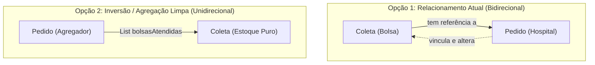

# Guia Didático e Arquitetural: Padrões, Enums e Lógica de Negócio do Hemocentro

Este documento detalha o funcionamento técnico, os princípios de design e as estruturas lógicas implementadas no sistema **Hemocentro**, explicando o racional das decisões que evoluíram a estrutura original do projeto de referência (`C:\Projetos\Java\inter\hemocentro`).

---

## 1. Comparativo: Projeto de Referência vs. Projeto Atual

O projeto de referência original serviu como fundação clássica de orientação a objetos (atributos privados, construtores e getters/setters). No entanto, para atender aos requisitos de **Clean Code**, **Null-Safety** e ao fluxo real de **controle de quantidade de bolsas e baixa de pedidos**, foram necessárias evoluções pontuais:

| Elemento | Projeto de Referência (`inter/hemocentro`) | Projeto Atual Refatorado | Por que mudou? (Motivação Arquitetural) |
| :--- | :--- | :--- | :--- |
| **Tipo Sanguíneo** | Classe `TipoSang` com `String tipo` | `enum TipoSanguineo` | Tipos sanguíneos no mundo real são exatamente 8 opções fixas. Usar `String` permitia erros como `"OB"`, `"banana"` ou espaços. O `enum` garante **segurança de tipos em tempo de compilação**. |
| **Status de Pedido e Análise** | `String status` livre | `enum StatusPedido` e `enum StatusAnalise` | Elimina "strings mágicas" soltas pelo código (`"Enviado"`, `"Em atendimento"`). Padroniza os ciclos de vida das entidades em estados bem definidos. |
| **Itens do Pedido** | `List<TipoSang> tipos` (sem quantidade) | `List<PedidoSangue> itens` | Um hospital não pede apenas "o tipo O+". Ele pede **quantidades específicas de bolsas** (ex: 2 bolsas de O+ e 1 de A-). Criou-se `PedidoSangue` com `quantidadeSolicitada` e `quantidadeAtendida`. |
| **Fluxo de Atendimento** | Manual no `Main` (setters soltos) | Método de negócio `pedido.darBaixa(coleta)` | No modelo antigo, a baixa era feita manualmente no `Main`. O novo método encapsula a regra dentro do domínio: valida tipo, incrementa atendimento e atualiza status. |
| **Inicialização dos Construtores** | Atributos objeto iniciavam como `null` | Inicialização defensiva (`new Endereco()`, etc.) | Evita que chamadas comuns como `hospital.getEndereco().getCidade()` quebrem a aplicação com `NullPointerException`. |
| **Volume em ML** | `int volumeMl` | `double volumeMl` | No laboratório, fracionamentos de hemocomponentes podem ter medidas decimais (ex: `60.5 ml`). |

---

## 2. Como as Classes `enum` Funcionam na Prática

Um `enum` (enumeração) em Java não é apenas uma lista de constantes; **ele é uma classe especial** com superpoderes de validação e imutabilidade.

### 2.1 Por baixo dos panos
Quando declaramos:
```java
public enum TipoSanguineo {
    A_POSITIVO("A+"),
    A_NEGATIVO("A-"),
    ...
    O_POSITIVO("O+"),
    NAO_INFORMADO("Não informado");

    private final String tipo;

    TipoSanguineo(String tipo) {
        this.tipo = tipo;
    }

    public String getTipo() {
        return tipo;
    }
}
```

O compilador Java cria instâncias únicas (Singletons) e imutáveis para cada constante.

### 2.2 Vantagens Práticas no Código

1. **Comparação Direta e Rápida com `==`:**
   Diferente de objetos comuns e Strings que exigem `.equals()`, enums podem ser comparados diretamente com `==`:
   ```java
   if (item.getTipoSanguineo() == tipoColeta) { ... }
   ```
   Isso é mais rápido na memória, mais legível e nunca lança `NullPointerException`.

2. **Impossibilidade de Valores Inválidos:**
   Não é possível criar um novo tipo em tempo de execução:
   ```java
   TipoSanguineo tipo = TipoSanguineo.OB; // O COMPILADOR NÃO DEIXA! Erro de compilação na hora.
   ```

3. **Uso limpo em `switch/case`:**
   Permite bifurcar regras clínicas sem risco de erros de digitação:
   ```java
   switch (doador.getTipoSanguineo()) {
       case O_NEGATIVO -> System.out.println("Doador Universal!");
       case AB_POSITIVO -> System.out.println("Receptor Universal!");
       default -> { }
   }
   ```

---

## 3. Por que Instanciamos Entidades Defensivamente com o Operador Ternário?

No construtor completo de classes como `Analise`, encontramos este padrão:

```java
public Analise(int codigo, StatusAnalise status, Coleta coleta, Tecnico tecnico) {
    this.codigo = codigo;
    this.status = status;
    this.coleta = (coleta != null) ? coleta : new Coleta();
    this.tecnico = (tecnico != null) ? tecnico : new Tecnico();
    this.producao = new ArrayList<>();
}
```

### 3.1 Anatomia do Operador Ternário `(condição) ? se_verdadeiro : se_falso`
A instrução:
```java
this.coleta = (coleta != null) ? coleta : new Coleta();
```
É exatamente equivalente a escrever:
```java
if (coleta != null) {
    this.coleta = coleta; // Se passou um objeto válido, usa ele
} else {
    this.coleta = new Coleta(); // Se passou null, cria um objeto vazio para não quebrar
}
```

### 3.2 O Conceito: *Defensive Programming* (Programação Defensiva) & *Null Object Pattern*
- Se fizéssemos apenas `this.coleta = coleta;` e alguém chamasse por descuido:
  ```java
  Analise analise = new Analise(501, StatusAnalise.APROVADA, null, tecnico);
  ```
- No momento em que outro ponto do sistema fizesse:
  ```java
  System.out.println(analise.getColeta().getCodigo()); // CRASH! NullPointerException
  ```
- Com o operador ternário, se alguém passar `null`, o atributo `this.coleta` recebe um `new Coleta()` padrão. O sistema não quebra e continua executando com segurança.

> [!NOTE]
> No construtor vazio (`public Analise()`), não há parâmetros recebidos, por isso simplesmente inicializamos direto com `this.coleta = new Coleta();`. No construtor completo, o ternário serve para aceitar o objeto que o usuário enviou, mas proteger caso ele mande `null`.

---

## 4. Análise Linha por Linha dos Métodos de Negócio (`for`, `if/else`, `List`)

A classe `Pedido` concentra a inteligência do fluxo hospitalar. Abaixo está a dissecação técnica de cada estrutura.

---

### 4.1 Método `adicionarItem`: Laço `for-each`, Acumulador e Adição

```java
public void adicionarItem(TipoSanguineo tipoSanguineo, int quantidadeBolsas) {
    for (PedidoSangue item : this.itens) {
        if (item.getTipoSanguineo() == tipoSanguineo) {
            item.setQuantidadeSolicitada(item.getQuantidadeSolicitada() + quantidadeBolsas);
            return;
        }
    }
    this.itens.add(new PedidoSangue(tipoSanguineo, quantidadeBolsas, 0));
}
```

#### Passo a Passo da Execução:
1. **O laço `for (PedidoSangue item : this.itens)`:**
   - Chamado de *enhanced for* ou *for-each*.
   - Percorre elemento por elemento da lista dinâmica `this.itens` (um `ArrayList<PedidoSangue>`).
   - A cada volta, a variável local `item` aponta para uma linha do pedido existente.

2. **O teste `if (item.getTipoSanguineo() == tipoSanguineo)`:**
   - Verifica se o pedido já tem uma solicitação cadastrada para aquele mesmo tipo de sangue.
   - **Se já existir:**
     - Em vez de criar um item duplicado, ele atualiza a quantidade existente:  
       `item.setQuantidadeSolicitada(item.getQuantidadeSolicitada() + quantidadeBolsas);`
     - **`return;` (Saída Precoce / *Early Exit*):**  
       Interrompe o método imediatamente! Ele não executa as voltas restantes do `for` e nem a linha que adiciona um novo item no final.

3. **A linha `this.itens.add(new PedidoSangue(tipoSanguineo, quantidadeBolsas, 0));`:**
   - Se o laço `for` rodar a lista inteira e **não encontrar** nenhum item com aquele tipo sanguíneo, a execução atinge esta linha.
   - Cria uma nova instância de `PedidoSangue` e a insere no final da lista com `quantidadeAtendida = 0`.

---

### 4.2 Método `darBaixa`: Validação, Atendimento Parcial e Transição de Estados

```java
public boolean darBaixa(Coleta coleta) {
    if (coleta == null) return false;

    TipoSanguineo tipo = coleta.getTipoSanguineo();
    for (PedidoSangue item : this.itens) {
        if (item.getTipoSanguineo() == tipo && !item.isAtendido()) {
            item.adicionarBaixa();
            coleta.setPedido(this);
            coleta.setStatus(StatusColeta.ENVIADA);

            if (isTotalmenteAtendido()) {
                this.status = StatusPedido.ATENDIDO;
                this.dataEnvio = LocalDate.now();
            } else {
                this.status = StatusPedido.EM_ATENDIMENTO;
            }
            return true;
        }
    }
    return false;
}
```

#### Passo a Passo da Execução:

1. **Cláusula Guarda (`Guard Clause`):**
   ```java
   if (coleta == null) return false;
   ```
   - Se a bolsa passada for nula, o método encerra na primeira linha retornando `false`. Evita qualquer processamento inútil ou erro de memória.

2. **Obtenção do Tipo:**
   ```java
   TipoSanguineo tipo = coleta.getTipoSanguineo();
   ```
   - Extrai o tipo sanguíneo da bolsa (que veio do doador).

3. **O Laço e a Condição Composta (`&&`):**
   ```java
   for (PedidoSangue item : this.itens) {
       if (item.getTipoSanguineo() == tipo && !item.isAtendido()) {
   ```
   - O `for` procura nos itens do pedido uma linha compatível.
   - O `if` exige duas condições verdadeiras simultaneamente:
     1. `item.getTipoSanguineo() == tipo`: O tipo sanguíneo da bolsa bate com o solicitado no item;
     2. `!item.isAtendido()`: O item **ainda não** foi totalmente atendido (ou seja, `quantidadeAtendida < quantidadeSolicitada`). O operador `!` inverte o booleano de `isAtendido()`.

4. **Efetivação da Baixa (Efeitos Colaterais Atômicos):**
   - `item.adicionarBaixa();`: Incrementa em `+1` o contador de bolsas atendidas daquele item;
   - `coleta.setPedido(this);`: Vincula a bolsa física a este pedido (`this` representa a própria instância do `Pedido`);
   - `coleta.setStatus(StatusColeta.ENVIADA);`: A bolsa sai do estoque e fica marcada como despachada.

5. **Transição de Status do Pedido (`if / else` aninhado):**
   ```java
   if (isTotalmenteAtendido()) {
       this.status = StatusPedido.ATENDIDO;
       this.dataEnvio = LocalDate.now();
   } else {
       this.status = StatusPedido.EM_ATENDIMENTO;
   }
   ```
   - Chama o método auxiliar `isTotalmenteAtendido()`.
   - Se todas as bolsas de todos os tipos já foram entregues: o pedido fecha com status `ATENDIDO` e crava a data de envio.
   - Se ainda faltam bolsas de outros tipos (ou do mesmo): o pedido passa para `EM_ATENDIMENTO`.
   - `return true;`: Informa ao chamador que a bolsa foi alocada com sucesso.

6. **Retorno `false` no final:**
   - Se o laço `for` terminar sem encontrar nenhum item compatível pendente (ex: a bolsa é de um tipo que o hospital não pediu, ou a cota daquele tipo já tinha sido preenchida), retorna `false`. A bolsa permanece intocada no estoque.

---

### 4.3 Método `isTotalmenteAtendido`: Padrão de Verificação Universal (*Short-Circuit*)

```java
public boolean isTotalmenteAtendido() {
    if (itens.isEmpty()) return false;
    for (PedidoSangue item : itens) {
        if (!item.isAtendido()) {
            return false;
        }
    }
    return true;
}
```

#### Passo a Passo da Execução:

1. **`if (itens.isEmpty()) return false;`:**
   - Um pedido vazio, sem nenhum item cadastrado, não pode ser considerado "atendido". Retorna `false`.

2. **O Teste de Falha Rápida (*Early Exit*):**
   - O laço `for` percorre cada item do pedido.
   - A pergunta em cada volta é: *“Este item ainda está pendente?”* (`!item.isAtendido()`).
   - Se **pelo menos um** item ainda estiver com bolsas faltando, o método retorna imediatamente `false`. Ele nem perde tempo olhando o resto da lista.

3. **O `return true;` final:**
   - Se o laço examinou todos os itens e **nenhum deles** falhou (todos estão com `quantidadeAtendida >= quantidadeSolicitada`), o fluxo alcança a última linha e retorna `true`.

---

## 5. Eliminação de Referências Nulas em `Coleta.pedido`: Opção 1 vs. Opção 2

Um dos maiores desafios no mapeamento de sistemas reais para Orientação a Objetos é lidar com relacionamentos que só se concretizam com o passar do tempo. A relação entre a bolsa de sangue (`Coleta`) e o pedido do hospital (`Pedido`) é o exemplo clássico.

### 5.1 O Dilema do `null` herdado do Banco Relacional
- No banco SQL Server (`hemocentro.sql`), a tabela `Coleta` possui a coluna:
  ```sql
  num_pedido INT NULL REFERENCES Pedido (num_pedido)
  ```
- Enquanto a bolsa está guardada na geladeira do hemocentro, o `num_pedido` é `NULL`. 
- No código Java antigo, isso se traduzia em `this.pedido = null;`. 
- **O problema:** se qualquer parte do sistema tentar ler `coleta.getPedido().getNumero()` antes do despacho, a aplicação quebra imediatamente com `NullPointerException`.

---

### 5.2 A Solução Implementada no Projeto: Opção 1 (Objeto Padrão + Método de Consulta)

Adotamos a **Opção 1** para manter o projeto 100% tradicional e compatível com o modelo do banco de dados, mas eliminando totalmente o `null`:

```java
public class Coleta {
    ...
    private Pedido pedido;

    public Coleta() {
        ...
        this.pedido = new Pedido(); // Instância padrão (Null-Safety)
    }

    public Coleta(..., Pedido pedido) {
        ...
        this.pedido = (pedido != null) ? pedido : new Pedido();
    }

    /**
     * Verifica se a coleta já foi vinculada a um pedido real de hospital (número > 0).
     */
    public boolean temPedido() {
        return this.pedido != null && this.pedido.getNumero() > 0;
    }
}
```

#### Como Funciona:
1. Uma bolsa recém-criada no estoque nasce com um `new Pedido()` cujo número é `0` (pedido vazio).
2. Se alguém executar `coleta.getPedido().getNumero()`, o sistema retorna `0` com total segurança, sem travar.
3. Para saber se a bolsa está livre para uso, o método `temPedido()` verifica se `numero > 0`.
4. No momento em que o hospital dá baixa (`pedido.darBaixa(coleta)`), a coleta recebe o pedido real:  
   `coleta.setPedido(this);` (agora com número real, ex: `9001`).

---

### 5.3 A Solução Arquitetural Avançada: Opção 2 (Inversão do Relacionamento / DDD)

Se fôssemos redesenhar a arquitetura seguindo os princípios mais puros de **Domain-Driven Design (DDD)** e desacoplamento, a **Opção 2** seria a modelagem ideal:

#### O Conceito:
Na vida real, uma bolsa de sangue física na geladeira é um **ativo de estoque independente**. Ela tem volume, data de validade e tipo sanguíneo. Ela **não sabe e não precisa saber** se um dia será enviada para o "Hospital de Base" ou para a "Santa Casa".

Quem precisa saber quais bolsas foram enviadas para quem é o **`Pedido`**!

#### Comparativo Visual (Mermaid):



#### Como Ficaria o Código na Opção 2:

**1. A classe `Coleta` ficaria 100% limpa (sem nenhuma referência a Pedido):**
```java
public class Coleta {
    private int codigo;
    private LocalDate dataColeta;
    private LocalDate dataValidade;
    private StatusColeta status;
    private Doador doador;
    private Funcionario funcionario;
    // NÃO EXISTE ATRIBUTO PEDIDO AQUI!
    // A bolsa é uma entidade pura de estoque.
}
```

**2. A classe `Pedido` passaria a guardar a lista das bolsas que a atenderam:**
```java
public class Pedido {
    private int numero;
    private Hospital hospital;
    private List<PedidoSangue> itens = new ArrayList<>();
    
    // Lista das bolsas reais que atenderam este pedido:
    private List<Coleta> bolsasAtendidas = new ArrayList<>();

    public boolean darBaixa(Coleta coleta) {
        if (coleta == null || coleta.getStatus() != StatusColeta.DISPONIVEL) {
            return false;
        }

        TipoSanguineo tipo = coleta.getTipoSanguineo();
        for (PedidoSangue item : this.itens) {
            if (item.getTipoSanguineo() == tipo && !item.isAtendido()) {
                item.adicionarBaixa();
                
                // O próprio Pedido guarda a bolsa atendida:
                this.bolsasAtendidas.add(coleta);
                coleta.setStatus(StatusColeta.ENVIADA);

                verificarConclusao();
                return true;
            }
        }
        return false;
    }
}
```

#### Vantagens da Opção 2:
- **Zero risco de nulo:** Como a `Coleta` sequer possui o campo `pedido`, é impossível ocorrer qualquer erro de ponteiro nulo relacionado a pedidos dentro dela.
- **Desacoplamento Perfeito:** A `Coleta` pode ser reutilizada em outros contextos do hemocentro sem carregar o conceito de pedido (por exemplo: descarte de bolsa vencida, envio para pesquisa científica ou controle de quarentena).
- **Rastreabilidade Completa no Pedido:** O hospital tem a lista exata de cada bolsa física despachada através de `pedido.getBolsasAtendidas()`.

---

## 6. Resumo das Boas Práticas para Apresentação Acadêmica / Técnica

Caso precise defender essa estrutura perante professores ou equipe técnica, você pode destacar estes quatro termos consagrados de engenharia de software:

1. **Encapsulamento de Regra de Negócio (Domain-Driven):**  
   A lógica de baixar bolsas não fica jogada no `Main`. Ela pertence ao `Pedido`, que conhece seus itens e sabe quando foi atendido.
2. **Fail-Safe / Zero NullPointerException:**  
   Construtores com inicialização não-nula e ternários garantem que o sistema continue de pé mesmo diante de dados incompletos.
3. **Type-Safety com Enums:**  
   O uso de enums para status e tipos sanguíneos transfere a validação para o compilador do Java, eliminando falhas humanas por digitação.
4. **Evolução Arquitetural Coleta/Pedido:**  
   Implementação da *Opção 1* (Objeto Padrão com `temPedido()`) para fidelidade ao DER clássico, com visão arquitetural da *Opção 2* (Inversão de Dependência via Agregação) para desacoplamento puro em DDD.
