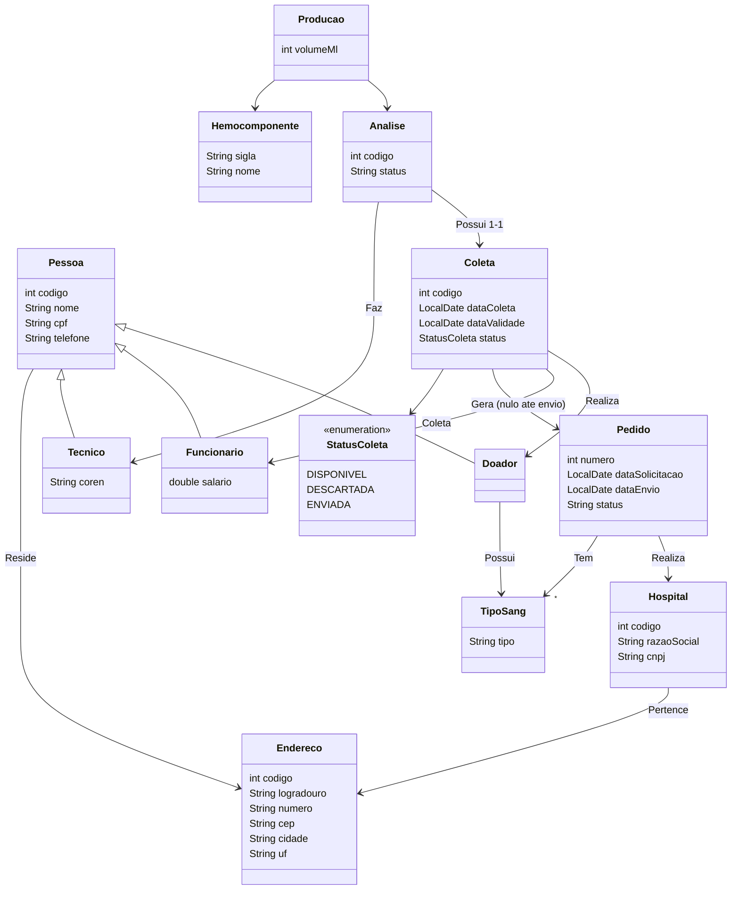

# Mapa de mudanças: modelo antigo → modelo Hemocentro

Documento de referência da migração das classes Java para a nova estrutura definida em `hemocentro.sql` e `mapeamento.md` (DER do professor).

- **Antes:** 13 classes em `src/` baseadas no modelo antigo (`banco_sangue.sql`: UF/Cidade/CEP, Bolsa, Solicitação).
- **Depois:** 13 classes em `src/` alinhadas às tabelas do `hemocentro.sql`.
- **Arquivos antigos:** preservados em `antigo/` (nada foi apagado).

---

## 1. Decisões que guiaram a migração

| # | Ponto | Decisão |
|---|---|---|
| 1 | Doador, Funcionário, Técnico | Herança: `extends Pessoa` |
| 2 | Padrão de nomes | camelCase Java (`dataColeta`, `TipoSang`, `getDataColeta`) |
| 3 | Salário (`DECIMAL(10,2)`) | `double` |
| 4 | Arquivos obsoletos | Movidos para `antigo/` na raiz (fora de `src/`, para o VS Code não compilá-los) |
| 5 | Construtores | Só dois por classe: vazio e completo |
| 6 | Construtor vazio | Referências iniciam com `null`, textos com `""` (sem criar objetos em cascata) |
| 7 | Status da coleta | `enum StatusColeta` (CHECK do SQL); padrão `DISPONIVEL` (DEFAULT do SQL) |
| 8 | Status do pedido e da análise | `String` (o SQL não define a lista de valores) |
| 9 | Relacionamento N:N `Tem` | Lista `List<TipoSang> tipos` dentro de `Pedido` |
| 10 | Relacionamento N:N `Produz` | Classe própria, porque tem o atributo `volumeMl` |
| 11 | Datas | `LocalDate` (as colunas do SQL são `DATE`) |
| 12 | CPF, CNPJ, CEP, telefone | `String` (números longos; `float` perdia dígitos) |

---

## 2. Mapa de classes (antes → depois)

| Classe antiga | Situação | Classe nova | Tabela SQL |
|---|---|---|---|
| `Uf` | Fundida | `Endereco` | `Endereco` |
| `Cidade` | Fundida | `Endereco` | `Endereco` |
| `Cep` | Fundida | `Endereco` | `Endereco` |
| `Pessoa` | Alterada | `Pessoa` | `Pessoa` |
| `Telefone` | Absorvida | `Pessoa.telefone` | `Pessoa.telefone` |
| `Doador` | Alterada | `Doador` | `Doador` |
| `Administrador` | Renomeada e alterada | `Funcionario` | `Funcionario` |
| — | Nova | `Tecnico` | `Tecnico` |
| `Tipo_Sanguineo` | Renomeada e simplificada | `TipoSang` | `TipoSang` |
| `Doacao` | Fundida | `Coleta` | `Coleta` |
| `Bolsa` | Fundida | `Coleta` (+ `Producao` para o volume) | `Coleta` / `Produz` |
| `Status` | Substituída | `StatusColeta` (enum) / `String` | CHECK de `Coleta.status` |
| `Solicitacao` | Renomeada e alterada | `Pedido` | `Pedido` |
| `Solicitacao_TipoSanguineo` | Absorvida | `Pedido.tipos` | `Tem` |
| — | Nova | `Hospital` | `Hospital` |
| — | Nova | `Analise` | `Analise` |
| — | Nova | `Hemocomponente` | `Hemocomponente` |
| — | Nova | `Producao` | `Produz` |

---

## 3. Mapa de atributos

### Endereco ← Uf + Cidade + Cep + Pessoa.logradouro

| Origem | Destino | Observação |
|---|---|---|
| — | `Endereco.codigo` (int) | Novo (`cod_endereco`) |
| `Pessoa.logradouro` | `Endereco.logradouro` | Saiu de Pessoa |
| — | `Endereco.numero` (String) | Novo |
| `Cep.nr` | `Endereco.cep` (String) | |
| `Cidade.nome` | `Endereco.cidade` (String) | Cidade deixa de ser objeto |
| `Uf.sigla` | `Endereco.uf` (String) | Guarda só a sigla |
| `Cidade.codigo`, `Uf.nome` | — | Removidos |

### Pessoa

| Antes | Depois | Observação |
|---|---|---|
| `codigo` (int) | `codigo` (int) | |
| `nome` | `nome` | |
| `cpf` (String) | `cpf` (String) | |
| `email` | — | Removido (não existe no SQL) |
| `logradouro` | — | Foi para `Endereco` |
| `cep` (Cep) | `endereco` (Endereco) | Relacionamento **Reside** |
| `Telefone.nr` (classe à parte) | `telefone` (String) | Um telefone por pessoa |

### Doador (extends Pessoa)

| Antes | Depois | Observação |
|---|---|---|
| `data_nascimento` | — | Removido (não existe no SQL) |
| `tipo_sanguineo` (Tipo_Sanguineo) | `tipoSanguineo` (TipoSang) | Relacionamento **Possui** |

### Funcionario (extends Pessoa) ← Administrador

| Antes | Depois | Observação |
|---|---|---|
| `cargo` | — | Removido (não existe no SQL) |
| `salario` (float) | `salario` (double) | |

### Tecnico (extends Pessoa) — nova

| Antes | Depois | Observação |
|---|---|---|
| — | `coren` (String) | Registro único no Conselho Regional de Enfermagem (`Tecnico.coren`) |

### TipoSang ← Tipo_Sanguineo

| Antes | Depois | Observação |
|---|---|---|
| `codigo` (int) | — | A chave passa a ser o próprio tipo |
| `grupo_abo` + `fator_rh` | `tipo` (String) | Ex.: `"A+"`, `"O-"` |

### Coleta ← Doacao + Bolsa

| Antes | Depois | Observação |
|---|---|---|
| `Doacao.nr` / `Bolsa.codigo` | `codigo` (int) | Uma coleta = uma doação = uma bolsa |
| `Doacao.data` (LocalDateTime) | `dataColeta` (LocalDate) | |
| `Bolsa.validade` | `dataValidade` (LocalDate) | |
| `Doacao.status` / `Bolsa.status` (Status) | `status` (StatusColeta) | `DISPONIVEL`, `DESCARTADA`, `ENVIADA` |
| `Doacao.doador` | `doador` (Doador) | Relacionamento **Realiza** |
| `Doacao.funcionario` (Administrador) | `funcionario` (Funcionario) | Relacionamento **Coleta** |
| `Bolsa.solicitacao` | `pedido` (Pedido) | Relacionamento **Gera**; nulo até o envio |
| `Bolsa.tipo_sanguineo` | — | Vem do doador (`coleta.getDoador().getTipoSanguineo()`) |
| `Bolsa.volume` | `Producao.volumeMl` | Volume passa a ser por hemocomponente |
| `Doacao.getAdministrador()` (alias) | — | Removido |

### Pedido ← Solicitacao + Solicitacao_TipoSanguineo

| Antes | Depois | Observação |
|---|---|---|
| `nr` | `numero` (int) | |
| `data` (LocalDateTime) | `dataSolicitacao` (LocalDate) | |
| — | `dataEnvio` (LocalDate) | Novo; nulo até o despacho |
| `status` (Status) | `status` (String) | |
| `administrador` (Administrador) | — | Removido; o pedido agora é do hospital |
| — | `hospital` (Hospital) | Relacionamento **Realiza** |
| `Solicitacao_TipoSanguineo` (tipo + qtd) | `tipos` (List&lt;TipoSang&gt;) | Relacionamento **Tem**; `qtd` removido (não existe no SQL) |

### Novas classes

| Classe | Atributos | Relacionamentos |
|---|---|---|
| `Hospital` | `codigo`, `razaoSocial`, `cnpj` | `endereco` (**Pertence**) |
| `Analise` | `codigo`, `status` (String) | `coleta` (**Possui** 1:1), `tecnico` (**Faz**) |
| `Hemocomponente` | `sigla`, `nome` | — |
| `Producao` | `volumeMl` (int) | `analise`, `hemocomponente` (N:N — tabela `Produz`) |
| `StatusColeta` (enum) | `DISPONIVEL`, `DESCARTADA`, `ENVIADA` | usado por `Coleta` |

---

## 4. Diagrama do modelo novo

---

## 5. Movimentação de arquivos

| Arquivo | Ação |
|---|---|
| `src/Uf.java`, `Cidade.java`, `Cep.java`, `Telefone.java`, `Status.java`, `Bolsa.java`, `Doacao.java`, `Solicitacao.java`, `Solicitacao_TipoSanguineo.java`, `Tipo_Sanguineo.java`, `Administrador.java` | Movidos para `antigo/` |
| `src/Pessoa.java`, `src/Doador.java` | Cópia da versão antiga em `antigo/`; reescritos em `src/` |
| `src/Endereco.java`, `Funcionario.java`, `Tecnico.java`, `TipoSang.java`, `Hospital.java`, `Pedido.java`, `Coleta.java`, `StatusColeta.java`, `Analise.java`, `Hemocomponente.java`, `Producao.java` | Criados |

---

## 6. Pendências

- [ ] Regras de negócio do mapeamento (seção 5) ainda não validadas nas classes, por exemplo: status `ENVIADA` somente quando a coleta tem pedido; `dataValidade >= dataColeta`; salário e volume maiores que zero.
- [ ] `bin/` ainda contém `.class` das classes antigas.
- [ ] `banco_sangue.sql` na raiz é do modelo antigo; substituir por `hemocentro.sql`.

