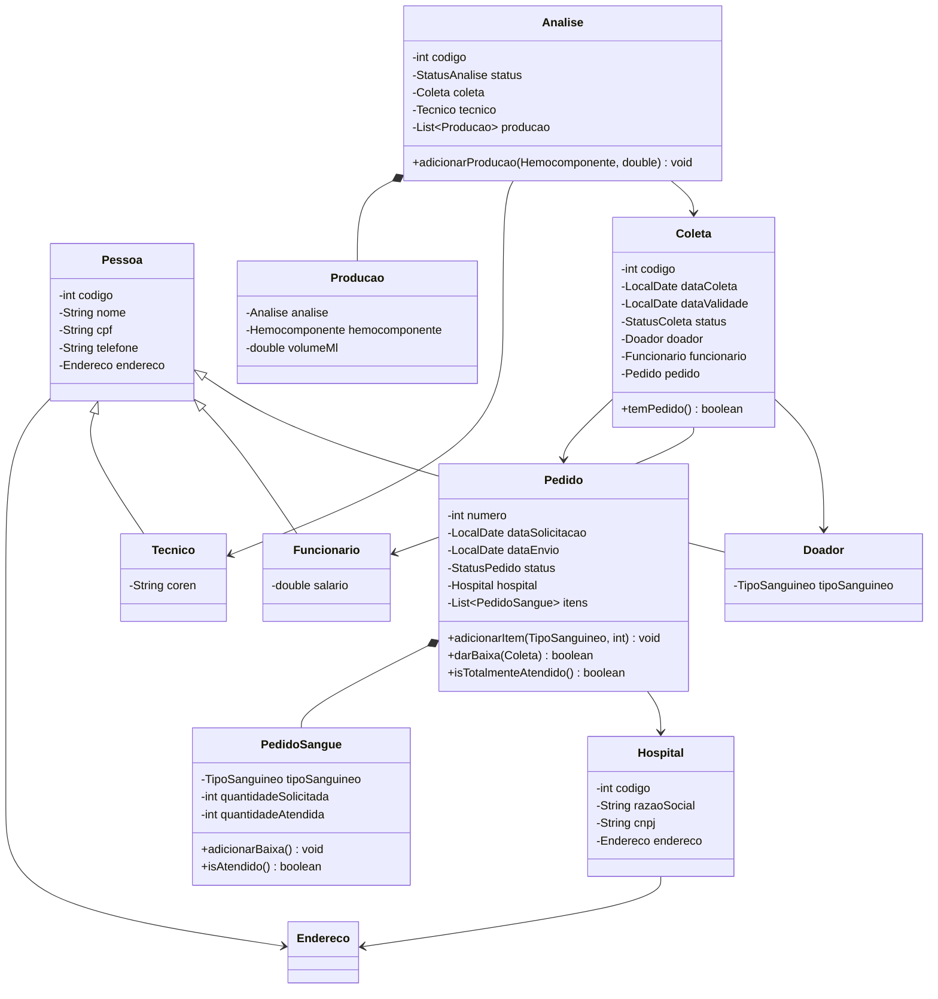

# Hemocentro — Sistema de Gestão Hemoterápica


---

## 🌐 Idiomas / Languages
- [🇧🇷 Português (PT-BR)](#-versão-em-português-pt-br)

---

# 🇧🇷 Versão em Português (PT-BR)

## 📌 Sobre o Projeto
O **Hemocentro** é um sistema orientado a objetos desenvolvido em Java para gerenciar o ciclo completo da hemoterapia:
1. **Cadastro e Triagem** de doadores e equipe médica/técnica;
2. **Coleta e Armazenamento** de bolsas de sangue no estoque;
3. **Análise Sorológica/Laboratorial** e fracionamento em hemocomponentes (Hemácias, Plaquetas, Plasma e Crioprecipitado);
4. **Gestão de Pedidos Hospitalares** com controle quantitativo de bolsas por tipo sanguíneo;
5. **Mecanismo de Baixa Atômica**, vinculando as bolsas coletadas e testadas diretamente às demandas pendentes dos hospitais.

O projeto foi refatorado e padronizado segundo os princípios de **Clean Code**, **Null-Safety** (blindagem contra `NullPointerException`) e **Type-Safety** através de enumerações.

---

## 🚀 Principais Funcionalidades

- **Null-Safety Absoluta:** Todas as entidades possuem construtores defensivos que inicializam objetos compostos (`Endereco`, `TipoSanguineo`, etc.), eliminando falhas por ponteiro nulo.
- **Tipagem Forte com Enums:**
  - `TipoSanguineo`: Representação segura dos 8 tipos (`A+`, `A-`, `B+`, `B-`, `AB+`, `AB-`, `O+`, `O-`, além de `NAO_INFORMADO`).
  - `StatusPedido`: Ciclo de vida (`PENDENTE`, `EM_ATENDIMENTO`, `ATENDIDO`, `CANCELADO`).
  - `StatusColeta`: Controle de estoque (`DISPONIVEL`, `DESCARTADA`, `ENVIADA`).
  - `StatusAnalise`: Controle de qualidade (`EM_ANALISE`, `APROVADA`, `REPROVADA`).
- **Controle Quantitativo de Demandas (`PedidoSangue`):** O hospital solicita quantidades exatas de bolsas por tipo sanguíneo, com contadores de bolsas solicitadas, atendidas e restantes.
- **Fluxo de Baixa Automática (`darBaixa`):** O método `pedido.darBaixa(coleta)` valida o tipo sanguíneo, confere o estoque, vincula a bolsa ao pedido, atualiza o status da coleta para `ENVIADA` e conclui o pedido automaticamente assim que todas as cotas são atendidas.

---

## 🏗️ Diagrama de Classes e Arquitetura



---

## 📂 Estrutura de Pastas

```text
hemocentro/
├── bin/                           # Bytecodes compilados (.class)
├── src/                           # Código-fonte Java
│   ├── Analise.java               # Análise laboratorial e sorológica
│   ├── Coleta.java                # Unidade de bolsa de sangue e coleta
│   ├── Doador.java                # Entidade doador voluntário
│   ├── Endereco.java              # Encapsulamento de dados de endereço
│   ├── Funcionario.java           # Profissional de triagem e coleta
│   ├── Hemocomponente.java        # Frações do sangue (CH, PFC, CP, CRIO)
│   ├── Hospital.java              # Unidade solicitante de sangue
│   ├── PedidoSangue.java          # Linha de pedido com controle de quantidade
│   ├── Main.java                  # Ponto de entrada e testes de simulação
│   ├── Pedido.java                # Pedido hospitalar e motor de baixa
│   ├── Pessoa.java                # Superclasse base para pessoas
│   ├── Producao.java              # Volume (ml) dos hemocomponentes produzidos
│   ├── StatusAnalise.java         # Enum de status da análise laboratorial
│   ├── StatusColeta.java          # Enum de status da bolsa no estoque
│   ├── StatusPedido.java          # Enum de ciclo de vida do pedido
│   ├── Tecnico.java               # Profissional de laboratório (COREN)
│   └── TipoSanguineo.java         # Enum com os tipos ABO/Rh
├── antigo/                        # Arquivos legados preservados
├── DIAGRAMA_CLASSES.md            # Diagrama completo em Mermaid
├── GUIA_ARQUITETURA_E_PADROES.md  # Documentação didática e padrões adotados
├── hemocentro.sql                 # Script DDL/DML para SQL Server
└── README.md                      # Documentação principal
```

---

## ⚙️ Como Compilar e Executar

### Pré-requisitos:
- **JDK 17** ou superior (testado com OpenJDK 21 LTS).

### 1. Compilação:
Abra o terminal na pasta raiz do projeto e execute:
```bash
javac -d bin src/*.java
```

### 2. Execução:
```bash
java -cp bin Main
```

---